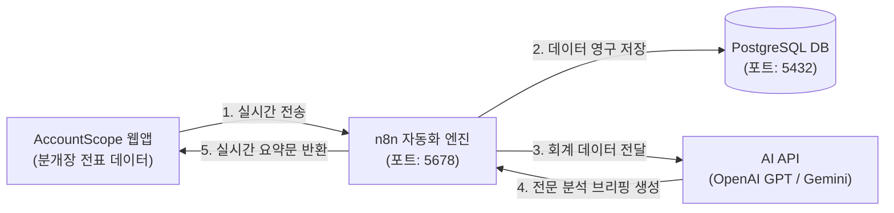

# 📘 AccountScope · n8n + DB + AI API 연동 가이드북

본 문서는 **회계 관리 시스템(AccountScope)**에 **n8n 자동화 파이프라인**, **PostgreSQL 데이터베이스**, 그리고 **실제 AI(OpenAI / Google Gemini) 요약 API**를 초보자도 5분 만에 세팅하고 연동할 수 있도록 단계별로 정리한 실무 매뉴얼입니다.

---

## 🧭 1. 전체 아키텍처 (한눈에 보기)

- **안전 설계 (Zero-Breaking):** n8n이나 Docker가 꺼져 있어도 화면이 멈추거나 에러가 나지 않으며, 기존 내장 통계 엔진으로 즉시 자동 폴백(Fallback)됩니다.

---

## 🛠️ 2. 사전 준비물 (2가지)

1. **Docker Desktop** (내 컴퓨터에서 실행할 경우): [https://www.docker.com](https://www.docker.com)에서 무료 설치 및 실행.
2. **AI API Key** (둘 중 1개 선택):
   - **OpenAI API Key**: [https://platform.openai.com/api-keys](https://platform.openai.com/api-keys)에서 발급 (`sk-...`)
   - **Google Gemini API Key**: [https://aistudio.google.com/app/apikey](https://aistudio.google.com/app/apikey)에서 무료 발급

---

## 🚀 3. 가장 쉬운 3단계 세팅법 (로컬 Docker 기준)

### [1단계] 원클릭 실행기 더블 클릭
1. 프로젝트 폴더에 있는 **`start_n8n_db.bat`** 파일을 마우스로 더블 클릭합니다.
2. 검은색 콘솔 창이 뜨면서 아래 작업이 자동으로 완료됩니다:
   - ✅ **PostgreSQL 15 데이터베이스**(포트: 5432) 자동 실행
   - ✅ 전표 원장 및 AI 이력 테이블(`init-db.sql`) 자동 생성
   - ✅ **n8n 자동화 서버**(포트: 5678) 자동 실행
   - ✅ 기본 웹 브라우저에서 `http://localhost:5678` 화면 자동 오픈

---

### [2단계] 워크플로우 템플릿 불러오기 (Import)
1. 브라우저에 열린 n8n 화면에서 우측 상단 파란색 **[Add workflow]** 버튼을 클릭합니다.
2. 화면 우측 상단의 점 세 개 버튼(`...`)을 누르고 **[Import from File]**을 클릭합니다.
3. 프로젝트 폴더에 준비되어 있는 **`n8n_accounting_ai_workflow.json`** 파일을 선택합니다.
4. 아래와 같이 5개의 노드가 연결된 완전체 회계 AI 워크플로우가 즉시 캔버스에 나타납니다:
   - `전표 데이터 수신 (Webhook)` ➔ `프롬프트 전처리` ➔ `AI 경영 진단 요약 (LLM)` ➔ `웹앱에 AI 요약문 응답` & `DB에 AI 요약 이력 저장`

---

### [3단계] 내 AI API 키 넣고 활성화 (Active)
1. 캔버스 아래쪽에 있는 **`OpenAI Chat Model`** 노드를 더블 클릭합니다.
   *(※ Gemini를 쓰실 경우 노드를 Gemini로 변경 가능)*
2. **Credential** 선택 창에서 **[Create New]** 클릭 ➔ 준비한 API Key(`sk-...`)를 붙여넣고 **[Save]**를 누릅니다.
3. 노드 창을 닫고, n8n 우측 상단의 스위치를 **`Inactive` ➔ `Active`**로 켜줍니다.
4. 우측 상단의 **[Save]** 버튼을 누르면 연동이 끝납니다!

---

## 🖥️ 4. 연동 결과 확인하기

1. **`start.bat`**을 실행하거나 브라우저에서 `index.html`을 엽니다.
2. 좌측 메뉴의 **[차기 매출 예측]**(`forecast.html`) 또는 **[경영 분석 보고서]**(`report.html`)로 이동합니다.
3. n8n이 켜져 있으면 상단 의견 상자에 다음과 같이 **실시간 AI 브리핑**이 자동으로 출력됩니다:

> **[경영 실적 및 추세 분석 (AI 실시간 연동)]**  
> *"2024년 총 매출은 186,000,000원으로 전년 대비 +12.6% 성장세를 기록하였으며, 영업 마진은 67,900,000원으로 수익성이 견조하게 개선되었습니다. 다만 지급수수료와 광고선전비의 증가 추세가 지속되고 있으므로 분기별 판관비 모니터링이 권장됩니다."*

---

## ☁️ 5. Docker 없이 무료 클라우드로 하는 법 (대안)

컴퓨터 사양이나 권한 문제로 Docker 설치가 어렵다면, 100% 무료 클라우드로도 동일하게 구성할 수 있습니다:

1. **무료 DB (Supabase)**:
   - [Supabase.com](https://supabase.com) 가입 ➔ [New Project] 생성
   - 좌측 메뉴 [SQL Editor]에 본 프로젝트의 `init-db.sql` 파일 내용을 붙여넣고 [Run] 실행.
2. **무료 n8n (n8n Cloud)**:
   - [n8n.io/cloud](https://n8n.io/cloud/) 무료 체험 생성 ➔ 동일하게 `n8n_accounting_ai_workflow.json` 가져오기.
   - Postgres 노드에 Supabase 접속 정보(Host, Port, User, Password)를 입력하면 클라우드에서 영구 보존됩니다.

---

## 🐬 5. HeidiSQL(x64) 연동 가이드 (MySQL / MariaDB / PostgreSQL)

HeidiSQL은 데이터베이스를 시각적으로 보고 쿼리할 수 있는 관리 도구입니다. 상황에 맞게 2가지 중 하나로 연동하시면 됩니다:

### [상황 A] 내 PC에 이미 MySQL/MariaDB가 설치되어 있고 HeidiSQL로 관리하는 경우
1. HeidiSQL을 실행하고 로컬 MySQL에 접속합니다 (보통 포트: `3306`, 사용자: `root`).
2. 상단 메뉴의 **[쿼리]** 탭을 클릭합니다.
3. 프로젝트 폴더의 **`init-mysql.sql`** 파일 내용을 전체 복사하여 붙여넣고 키보드 **`F9`**(실행)를 누릅니다.
   - `accountscope` 데이터베이스와 전표/AI 테이블이 1초 만에 자동 생성됩니다.
4. **n8n 연동 노드 변경:**
   - n8n 캔버스에서 우측의 `Postgres` 노드를 지우고, `+` 버튼에서 **`MySQL`** 노드를 추가합니다.
   - Host: `host.docker.internal` (Docker n8n 기준) 또는 `127.0.0.1`
   - Port: `3306`, User: `root`, DB: `accountscope`

---

### [상황 B] 방금 실행한 AccountScope PostgreSQL DB를 HeidiSQL로 열어보는 경우
HeidiSQL(x64)은 PostgreSQL도 기본 지원합니다!
1. HeidiSQL 실행 ➔ 좌측 하단 **[신규]** 클릭
2. 접속 설정 입력:
   - **네트워크 유형**: `PostgreSQL` 선택
   - **호스트명 / IP**: `127.0.0.1`
   - **사용자**: `account_user`
   - **암호**: `account_password123`
   - **포트**: `5432`
   - **데이터베이스**: `accountscope`
3. 하단 **[열기]**를 누르면, 웹사이트와 n8n에서 실시간으로 쌓이는 회계 전표와 AI 요약 로그 테이블을 HeidiSQL 화면에서 바로 확인하실 수 있습니다!

---

## ❓ 6. 자주 묻는 질문 (FAQ & 트러블슈팅)

**Q1. AI API 키가 없거나 만료되면 웹사이트가 멈추나요?**  
- **절대 멈추지 않습니다.** `common.js`에 2초 타임아웃 및 자동 폴백 안전장치가 탑재되어 있어, AI API 연결이 안 되면 0.001초 만에 기존 내장 통계 엔진(`generateAIOpinion`)으로 자동 전환됩니다.

**Q2. DB에 저장된 실제 데이터를 직접 눈으로 확인하려면?**  
- DBeaver, TablePlus, 또는 VS Code 확장프로그램(PostgreSQL)에서 아래 접속 정보를 입력하시면 됩니다:
  - **Host**: `localhost`
  - **Port**: `5432`
  - **Database**: `accountscope`
  - **Username**: `account_user`
  - **Password**: `account_password123`
  - 테이블: `accounting_journals`(원장), `accounting_ai_summaries`(AI 요약 로그)

**Q3. 서비스를 완전히 끄고 싶을 때는?**  
- 터미널이나 CMD 창에서 프로젝트 폴더로 이동 후 `docker compose down`을 입력하시면 메모리 점유 없이 깔끔하게 종료됩니다.
